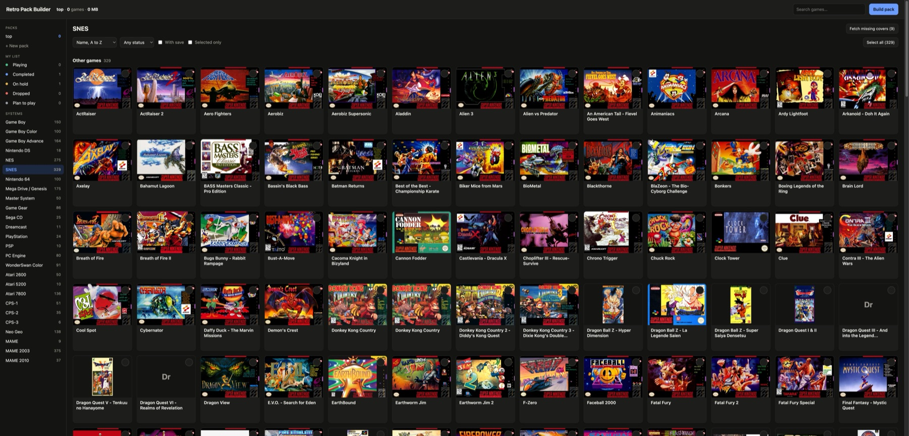

# Retro Pack Builder

Curate pocket-sized game packs from a big ROM archive, keep track of what you are playing, and build a folder you can copy straight onto a handheld's SD card.



Your archive stays the single source of truth: all your ROMs, saves and covers on a NAS or home server. Retro Pack Builder is a small web app next to it. You pick the games you actually want to carry, keep as many named packs as you like (`top`, `rpg`, `ds-favourites`), and press **Build pack** to get an SD card ready layout with clean names, covers and your saves.

## Features

- **Browse by system with box art.** Covers keep each system's own shape: PSP boxes are tall, SNES boxes are wide, GBA boxes are square. The shape is measured from your covers, not hard coded.
- **Multiple saved packs.** Create, switch, duplicate, rename and delete packs. Each pack is a plain text file you can also edit by hand.
- **Fast selection.** Click a cover, use *Select all* / *Deselect all* on whatever is currently filtered, or drag a card onto a pack in the sidebar.
- **Play status, MyAnimeList style.** Mark games as Playing, Completed, On hold, Dropped or Plan to play, then browse each list. Stored in SQLite.
- **Sort and filter** by name, size, status, or games that have a save.
- **Save aware.** Games with a save file show a disk icon, and building a pack copies each save next to its ROM.
- **One-click box art.** Fetch missing covers from [libretro-thumbnails](https://github.com/libretro-thumbnails). Arcade short names (`sf2.zip`) are turned into real titles with the [libretro-database](https://github.com/libretro/libretro-database) DAT files.
- **ROCKNIX style output.** `<system>/<rom>`, `<system>/images/`, a `gamelist.xml` with clean names, and multi-disc games shown as a single `.m3u` entry.
- **Free packs.** ROMs and covers are hardlinked into the pack folder, so a pack takes no extra space on the archive disk.
- **Scriptable.** Everything the UI does is a small JSON API, so scripts and AI agents can manage packs too. `GET /api` describes it.
- **Calm motion.** Cards glide to their new place instead of jumping, menus and dialogs ease in. Short, and off when your system asks for reduced motion.
- **No dependencies.** Python standard library only. Runs in a stock `python:3.12-alpine` container.

## Archive layout

Point Retro Pack Builder at a folder laid out like this:

```text
retro/                        your RETRO_DIR
├── roms/<system>/            games: one file per game, or one folder per multi-disc game with an .m3u inside
├── saves/<system>/           battery saves, named after the ROM:  Metroid Fusion (USA).srm
├── media/<system>/boxart/    covers, named after the ROM:         Metroid Fusion (USA).png
├── media/<system>/names.tsv  optional display names (filled in automatically for arcade sets)
├── bios/                     copied into every pack
├── packs/<name>.txt          pack lists (created from the web UI)
├── packs/<name>/             built packs (generated, safe to delete)
└── library.db                play status (created from the web UI)
```

**The one naming rule:** a save and a cover belong to a game when they have the same file name as the ROM, without the extension. Rename a ROM and you rename its save and cover too.

System folders use the common ROCKNIX / Batocera / ES-DE names: `gb`, `gbc`, `gba`, `nds`, `nes`, `snes`, `n64`, `megadrive`, `mastersystem`, `gamegear`, `segacd`, `dreamcast`, `psx`, `psp`, `pcengine`, `wonderswancolor`, `neogeo`, `cps1`, `mame` and so on. Any other folder under `roms/` shows up too, labelled with its folder name.

## Quick start with Docker

```sh
git clone https://github.com/cobanov/retro-pack-builder.git
cd retro-pack-builder
cp .env.example .env      # set RETRO_DIR, PUID and PGID
docker compose up -d
```

Then open `http://<your-server>:8790`.

`PUID` and `PGID` should be the owner of your archive files (run `id` on the server to see yours), so everything the app writes stays yours instead of root's.

## Running without Docker

Python 3.9 or newer, nothing to install:

```sh
RETRO=/path/to/retro python3 app.py
```

## Configuration

| Variable | Default | What it does |
|---|---|---|
| `RETRO` | `/retro` | Archive root (inside the container). With Docker, set `RETRO_DIR` in `.env` instead. |
| `PACKS` | `$RETRO/packs` | Folder for pack lists and built packs. |
| `PACK` | `top` | Pack shown on first visit. |
| `DB` | `$RETRO/library.db` | SQLite file for play status. |
| `PORT` | `8790` | Port the web UI listens on. |
| `BUILDER` | `build-pack.py` next to `app.py` | Pack builder script. |
| `GITHUB_TOKEN` | unset | Optional. Raises GitHub's limit for cover lookups (see below). |
| `CORS_ORIGIN` | unset | Set (for example `*`) to let browser apps on other origins call the API. Not needed for scripts or agents. |

## Building a pack

1. Pick a pack in the sidebar and select games.
2. Press **Build pack**. The pack is written to `packs/<name>/`.
3. Copy the contents of that folder to the root of your handheld's games partition. For example:

```sh
rsync -rt /srv/games/retro/packs/top/ /Volumes/GAMES/
```

You can also build from the command line:

```sh
RETRO=/srv/games/retro python3 build-pack.py /srv/games/retro/packs/top.txt
```

A pack list is a text file with one game per line, as `<system>/<file name>`. Lines starting with `#` are comments, and `## Heading` lines group games. Add `| Display name` to override the name shown on the device:

```text
## SNES
snes/Chrono Trigger (USA).zip
snes/Final Fantasy III (USA) (Rev 1).zip | Final Fantasy VI
psx/Final Fantasy VII (USA)
```

The builder needs the pack folder and the archive on the same filesystem, because it uses hardlinks.

## Box art

Use **Fetch missing covers** on a system page, or on the pack page to do every system at once. From the command line:

```sh
RETRO=/srv/games/retro python3 boxart.py            # every system
RETRO=/srv/games/retro python3 boxart.py gba snes   # just these
```

- Covers come straight from [libretro-thumbnails](https://github.com/libretro-thumbnails) on GitHub, and arcade titles from [libretro-database](https://github.com/libretro/libretro-database). Nothing goes through this project.
- Only missing covers are downloaded; existing ones are never replaced.
- Matching tries the exact libretro name first, then the same title ignoring region and revision tags, preferring USA, World, Europe and Japan releases in that order.
- ROM hacks and homebrew usually have no cover there. Drop your own PNG into `media/<system>/boxart/` with the ROM's name.
- Cover listings use the GitHub API (two requests per system, cached for a week in `media/.cache/`). Anonymous use allows 60 requests an hour, which is plenty for normal use. For a huge first run, set `GITHUB_TOKEN`.

## Saves and play status

- Saves are read from `saves/<system>/<rom name>.srm`, `.sav` or `.dsv`. When you build a pack, each selected game's save is copied next to its ROM, which is where ROCKNIX expects it.
- Play status lives in `library.db`, table `game_status (rel, status, updated_at)`, keyed by `<system>/<file>`.

## HTTP API (scripts and agents)

The web UI is a thin client over a JSON API, so anything you can click you can also script. `GET /api` returns a machine-readable list of every endpoint with example bodies: point an AI agent at it and it can find games, build packs and update your play status on its own.

Games are identified by `rel`, which is `<system>/<file name>` exactly as under `roms/`. Calls act on one pack: `?pack=<name>` on GET requests, `"pack"` in the JSON body on POST requests.

| Method | Path | What it does |
|---|---|---|
| GET | `/api` | Describes the API |
| GET | `/api/games?q=chrono trigger` | Searches every system by name or file name |
| GET | `/api/games?sys=snes` | All games of a system, with `selected` for the current pack |
| GET | `/api/games?status=playing` | Games with a play status |
| GET | `/api/games?pack=top` | The games in a pack |
| GET | `/api/summary?pack=top` | Systems, counts, pack size, saved packs, status counts |
| GET / POST | `/api/packs` | List packs / `create`, `duplicate`, `rename`, `delete` |
| POST | `/api/toggle` | Add (`"on": true`) or remove games: `{"pack": "top", "rels": [...], "on": true}` |
| POST | `/api/status` | Set or clear a status: `{"rel": "...", "status": "completed"}` |
| POST | `/api/build` | Build a pack: `{"pack": "top"}` |
| GET / POST | `/api/boxart` | Progress / start fetching missing covers: `{"sys": "gba"}` |
| GET | `/art?rel=...` | A game's cover image |

A complete session with curl:

```sh
API=http://localhost:8790
H='Content-Type: application/json'

# Find the exact rel of a game
curl -s -G $API/api/games --data-urlencode "q=chrono trigger"

# Make a pack, add the game, mark it as playing and build the pack
curl -s -X POST $API/api/packs  -H "$H" -d '{"action": "create", "name": "rpg"}'
curl -s -X POST $API/api/toggle -H "$H" -d '{"pack": "rpg", "rels": ["snes/Chrono Trigger (USA).zip"], "on": true}'
curl -s -X POST $API/api/status -H "$H" -d '{"rel": "snes/Chrono Trigger (USA).zip", "status": "playing"}'
curl -s -X POST $API/api/build  -H "$H" -d '{"pack": "rpg"}'
```

## Security

There is no login, for the web UI or the API. Run it on a network you trust, or behind a reverse proxy that adds authentication. The app writes to your archive (pack lists, covers, `library.db`), so do not expose it directly to the internet. Leave `CORS_ORIGIN` unset unless you need it: with it set, any web page open in your browser could call the API on your network.

## Project files

| File | Purpose |
|---|---|
| `app.py` | Web server and JSON API |
| `index.html` | The whole web UI (no build step) |
| `build-pack.py` | Builds a pack folder from a pack list |
| `boxart.py` | Fetches missing covers from libretro-thumbnails |
| `docker-compose.yml`, `.env.example` | Container setup |

## Legal

This project does not include, download or link to games or BIOS files. Use it with games you own. Box art and game metadata come from the libretro-thumbnails and libretro-database projects; see their repositories for their terms.

## License

[MIT](LICENSE)
